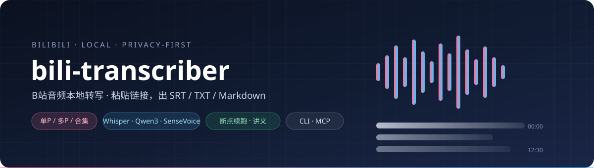
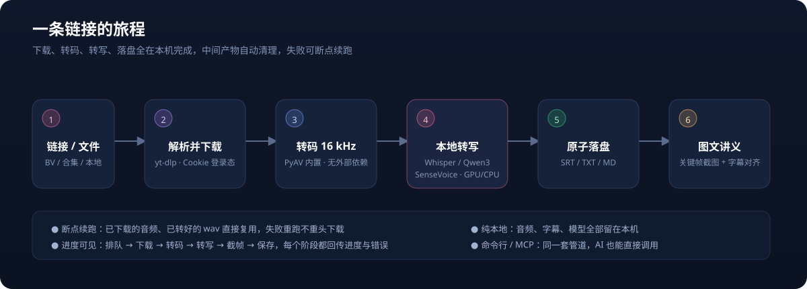
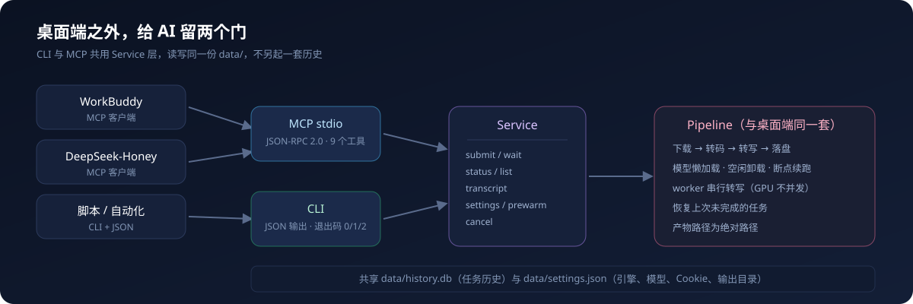

<div align="center">



# bili-transcriber

**粘贴一个链接，拿回一份可用的文字稿。下载、转码、转写全在你自己的机器上完成。**

[](pyproject.toml)
[](https://nicegui.io)
[](#三个识别引擎)
[](#ai-集成cli--mcp)
[](tests)
[](#系统要求)

</div>

> 本 README 对应 **v0.1.39** — 版本号取自 `pyproject.toml` 单一来源，发布时由 `scripts/release.py` 自动递增。

---

## 目录

| 章节 | 你会得到什么 |
|---|---|
| [一句话的旅程](#一句话的旅程) | 从链接到字幕，中间到底发生了什么 |
| [功能一览](#功能一览) | 支持哪些平台、引擎、输出 |
| [安装](#安装) | 四种形态，任选其一 |
| [快速开始](#快速开始) | 三分钟跑通第一个任务 |
| [使用说明](#使用说明) | 三个页签逐页讲清 |
| [20 个使用实例](#20-个使用实例) | 直接抄走的真实场景 |
| [命令行参考](#命令行参考) | 26 个参数全表 |
| [AI 集成（CLI / MCP）](#ai-集成cli--mcp) | 让 WorkBuddy 等直接调用 |
| [输出结构](#输出结构) | 产物长什么样 |
| [常见问题](#常见问题) | 10 个高频坑 |
| [数据与隐私](#数据与隐私) | 什么会联网、什么不会 |
| [开发与测试](#开发与测试) | 源码运行、跑测试、打包 |
| [文档](#文档) | 手册索引、架构与模块职责入口 |

---

## 一句话的旅程



一条链接进来，经过五道工序：

1. **探测** — 认出是哪个平台，把短链展开，把「合集」「多 P」拆成一条条独立任务。
2. **下载** — 只取最佳音轨（开启图文讲义时改取视频流），落到本地缓存。
3. **转码** — FFmpeg 统一成 16 kHz 单声道 WAV，这是所有引擎都吃得下的格式。
4. **转写** — 本地模型推理，GPU 优先、失败自动回退 CPU。
5. **落盘** — SRT / TXT / Markdown 三件套，可选的图文讲义 Markdown。

任何一步失败，重跑会**复用已完成的缓存**，不会从头再来。

---

## 功能一览

### 支持平台

| 平台 | 免登录 | 备注 |
|---|:---:|---|
| B 站 | ✅ | 单 P / 多 P / 合集自动展开；支持 Cookie 拿高码率 |
| 抖音 | ⚠️ | 精选内容需配浏览器 Cookie |
| 小红书 | ⚠️ | 同上 |
| 快手 | ✅ | 自研 SSR 解析，不走 yt-dlp |
| YouTube | ⚠️ | 需网络代理；部分视频需 Cookie |
| 本地文件 | ✅ | 14 种音视频格式直接转写 |

### 三个识别引擎

| 引擎 | 模型 | 适合谁 |
|---|---|---|
| **Whisper**（默认） | `large-v3-turbo` / `large-v3` / `medium` / `small` / `base` / `tiny` | 准确率优先，支持 CUDA 加速 |
| **Qwen3-ASR** | `Qwen3-ASR-0.6B` / `1.7B` | 中文口语、方言口音表现好 |
| **SenseVoice** | `SenseVoiceSmall` | 体积小、速度快，CPU 也跑得动 |

三个引擎共享同一套流程与输出格式，设置页切换即生效，不需要改代码。

### 其他

- **断点续跑** — 失败重跑跳过已完成的下载 / 转码。
- **图文讲义** — 自动识别 PPT 翻页画面，生成「时间戳 + 截图 + 该页字幕」的讲义。
- **系统托盘** — 关窗不退出，任务继续跑。
- **单实例保护** — 重复启动只会把已有窗口调出来，不会抢同一个任务。
- **纯本地** — 转写过程不调用任何外部 AI API。

---

## 安装

### 系统要求

| 项目 | 要求 |
|---|---|
| 操作系统 | Windows 10 / 11（已验证）；macOS / Linux 未验证 |
| Python（源码模式） | ≥ 3.11 |
| GPU（可选） | NVIDIA + CUDA 12.x；无卡自动回退 CPU |
| FFmpeg | **不用装**，随包内置静态版 |
| 磁盘 | 程序约 700 MB，Whisper 模型 1.6 GB，GPU 包 1.3 GB |

### 四种形态

| 形态 | 文件 | 适合 |
|---|---|---|
| 安装版 | `bili-transcriber-setup-{ver}.exe` | 普通用户，向导安装，建快捷方式 |
| 便携包 | `bili-transcriber-portable-{ver}.zip` | 解压即用，不写注册表，可放 U 盘 |
| 单文件版 | `bili-transcriber-single-{ver}.exe` | 临时用一次；CPU 模式，首启解压较慢 |
| 源码 | `pip install -e .` | 开发、调试、二次开发 |

### GPU 加速包（可选）

安装版与便携包默认 CPU 推理。要让 Whisper 走 NVIDIA 显卡：

1. 下载 `bili-transcriber-gpu-{ver}.zip`（约 1.3 GB，含 17 个 CUDA DLL）。
2. 解压到 `%LOCALAPPDATA%\Bili Note\gpu\`，**保留 zip 内的 `nvidia/<包>/bin/` 结构**（程序按这个结构找 DLL，压平会找不到）。
3. 重启应用 —— 程序自动注册 DLL 目录，无需配环境变量。

> 没装 GPU 包也不会报错：程序静默回退 CPU，只是慢一些。

---

## 快速开始

```powershell
# 1. 装（源码模式）
python -m venv .venv
.venv\Scripts\pip install -e .

# 2. 跑
.venv\Scripts\python -m app.main

# 3. 浏览器自动打开 http://127.0.0.1:8765
```

在输入框粘贴 `https://www.bilibili.com/video/BV1xxxxxxxxx`，点「添加」。

第一次跑会下载模型（约 1.6 GB，走国内镜像），之后完全离线。10 分钟的视频在 RTX 3060 上大约 40 秒出字幕。

---

## 使用说明

界面三个页签：**任务 / 历史 / 设置**。

### 任务（Tasks）

1. 输入框粘贴链接 → 点「添加」。
2. 系统自动探测，把单 P / 多 P / 合集展开成多条任务。
3. 状态依次推进：`queued → downloading → converting → transcribing → saving → done`（开讲义会多一段 `extracting`）。
4. 每行可单独操作：**打开所在文件夹** / **重新运行** / **取消**。

**转写本地文件有两个入口：**

- **选择文件（推荐）** — 弹系统原生文件框，直接引用原路径，零拷贝秒提交，大文件首选。
- **浏览器上传** — 手机或另一台电脑访问本机网页时才用；走 base64 传输，大文件明显慢。副本存在 `uploads/`，不会自动删除。

支持格式：`mp4 mkv mov avi webm flv wmv mp3 m4a wav ogg opus flac aac`。

### 历史（History）

已完成任务的索引，存在本地 SQLite（`data/history.db`）。可按状态 / 关键字筛选，每行可打开文件夹或重跑。

清空历史不会删产物文件，只删索引。

### 设置（Settings）

全部存在 `data/settings.json`，有「恢复默认」一键还原。

| 设置 | 可选值 | 说明 |
|---|---|---|
| 识别引擎 | whisper / qwen3-asr / sensevoice | 切换后模型列表自动跟随 |
| 转写模型 | 按引擎而定 | whisper 默认 `large-v3-turbo` |
| 设备 | auto / cuda / cpu | 有 N 卡选 `auto` |
| 计算精度 | auto / float16 / int8_float16 / int8 | 显存不足改 `int8` |
| 语言 | 空 = 自动 / zh / en | 中文视频指定 `zh` 更快更准 |
| 保留音频 | 开 / 关 | 是否保留原始音频文件 |
| VAD | 开 / 关 | 纯音乐场景会自动关闭重试 |
| 图文讲义 | 开 / 关 | B 站任务改下视频流，体积明显变大 |
| 模型目录 | 路径 | 默认 `%LOCALAPPDATA%\Bili Note\models` |
| 浏览器 Cookie | 不使用 / Chrome / Edge / Firefox / Brave / Opera / Vivaldi | 抖音精选、部分 YouTube 需要 |
| cookies.txt | 文件路径 | **优先于**浏览器 Cookie |
| 网络代理 | 如 `http://127.0.0.1:7890` | YouTube 等境外平台需要 |
| 输出目录 | 路径 | 默认 `output/` |
| 并发数 | 整数 | 下载/转码并发，转写始终串行 |

> 设置页保存前会校验：引擎 / 设备白名单，输出目录实际可创建可写。填错直接拒绝并提示原因。

---

## 20 个使用实例

### 入门三例

**1. 单个视频转字幕（最常用）**

```
粘贴 https://www.bilibili.com/video/BV1xx411c7mD → 添加
→ output/BV1xx411c7mD_标题/标题.srt
```

**2. 一次搞定整个系列（多 P / 合集）**

```
粘贴带 ?p=1 的分 P 链接或合集链接 → 添加
→ 自动展开为 N 条任务，逐条转写
→ 同一合集的分 P 共享一个输出目录，文件名带 _P01 / _P02 后缀区分
```

中途某 P 失败不影响其他，重跑只补失败那条。

**3. 把手机录的语音备忘转成文字**

```
任务页 → 选择文件(推荐) → 选中 D:\录音\会议.m4a
→ output/本地_会议/会议.txt
```

---

### 日常四例

**4. 给视频加双语字幕（先出中文稿，再人工翻）**

设置 `语言 = zh`、`计算精度 = int8_float16` → 转写 → 拿到 `.srt` → 导入 Aegisub / Subtitle Edit 翻译 → 导出双语。

**5. 只想读文字，不要时间戳**

```powershell
bili-transcriber-cli "https://www.bilibili.com/video/BV1xx411c7mD" --json
# 然后直接读 txt 产物，或：
bili-transcriber-cli --result BV1xx411c7mD_p1 --format txt
```

**6. 提取某段话的位置（做笔记要贴时间点）**

打开 `.md` 产物，每段前面就是 `[hh:mm:ss]` 时间戳，复制即可。需要精确到秒时用 `.srt`。

**7. 批量转写一个文件夹里的所有录音**

```powershell
Get-ChildItem D:\录音\*.m4a | ForEach-Object {
    .venv\Scripts\bili-transcriber-cli $_.FullName --json --timeout 3600
}
```

---

### 进阶五例

**8. 提取课程 PPT 讲义（图文讲义）**

设置页开「图文讲义」→ 转写 → 得到 `标题.notes.md` + `标题_frames/slide_*.jpg`。

每页 = 可点击时间戳 + 关键帧截图 + 该画面期间的字幕。适合技术分享、公开课。

**9. 显存不够，降精度接着跑**

报 `CUDA out of memory` → 计算精度改 `int8`（占用减半）→ 重跑，**缓存命中不会重新下载**。

**10. 换更快的模型做粗剪**

设置 `模型 = small` + `设备 = cuda` → 转写速度提升数倍，准确率略降。适合先粗看内容再决定要不要精修。

**11. 中文口语 / 方言重的访谈**

设置 `引擎 = qwen3-asr`、`模型 = Qwen3-ASR-1.7B`。中文口语和口音场景通常比 Whisper 更稳。

> 1.7B 在 CPU 上约为 0.6B 的 3 倍耗时，程序会主动提示。有 GPU 时快得多。

**12. 纯老 CPU 机器也能跑**

设置 `引擎 = sensevoice`、`设备 = cpu`。模型只有几百 MB，速度可接受。

---

### 平台三例

**13. 抖音精选视频下不下来**

设置页配「浏览器 Cookie = Chrome」（先在该浏览器登录抖音）→ 重试。如果仍失败，改用导出 `cookies.txt` 填路径（优先级更高）。

**14. YouTube 视频要代理**

设置「网络代理 = `http://127.0.0.1:7890`」→ 重试。代理变更后程序会清空网络探测缓存重新测。

**15. 快手链接直接丢进来**

`https://v.kuaishou.com/xxxxx` 分享链免登录解析，走自研 SSR 通道，不需要 Cookie。

---

### AI 集成三例

**16. 让 AI 助手直接转写（MCP）**

```jsonc
// 客户端配置
{"mcpServers": {"bili-transcriber": {
  "command": "C:\\Program Files\\Bili Note\\bili-transcriber.exe",
  "args": ["--mcp"]}}}
```

然后在对话里说「把这个链接转成文字稿」，AI 自己调 `transcribe` → `wait_jobs` → `get_transcript`。

**17. 脚本里等任务跑完再取结果**

```powershell
bili-transcriber-cli "https://www.bilibili.com/video/BV1xx411c7mD" --json --timeout 1800
# 退出码 0 = 全部成功；返回体里含 state / jobs / outputs
```

**18. 只提交不等待，回头再收**

```powershell
bili-transcriber-cli "https://..." --no-wait      # 提交即返回
bili-transcriber-cli --list --status-filter done  # 稍后查
bili-transcriber-cli --result BV1xx411c7mD_p1 --format srt
```

> `--no-wait` 提交的任务留在队列里；**下次启动桌面端会自动续跑**，不会变成僵尸任务。

---

### 排障两例

**19. 任务卡住不动，看日志**

任务页下方「运行日志」实时滚动，能看到当前阶段和真实报错。想看更细的，读 `%LOCALAPPDATA%\Bili Note\logs\app.log`（2 MB 轮转，保留 3 份）。

**20. 端口被占用起不来**

```powershell
$env:BILI_PORT = "9000"
.venv\Scripts\python -m app.main
```

或者：程序已经检测到单实例在跑 —— 它会直接把现有窗口打开然后退出，这是正常行为。

---

## 命令行参考

安装后在 `Scripts\` 下得到 `bili-transcriber-cli`（源码模式）。打包版没有独立可执行文件，改用分发前缀：

```
bili-transcriber.exe --cli <同样参数>
bili-transcriber.exe --mcp          # MCP stdio 服务
bili-transcriber.exe --version
```

`--cli` / `--mcp` 在进入 GUI 之前就被拦下分发，不会启动窗口。

### 提交任务

| 参数 | 说明 |
|---|---|
| `source` | 视频链接或本地音视频路径（位置参数） |
| `--no-wait` | 只提交不等待，任务留在队列 |
| `--timeout` | 等待上限秒数，默认 600 |
| `--output-dir` | 覆盖输出目录 |
| `--engine` | `whisper` / `qwen3-asr` / `sensevoice` |
| `--model` | Whisper 模型名，如 `large-v3-turbo` |
| `--device` | `auto` / `cuda` / `cpu` |
| `--compute-type` | `auto` / `float16` / `int8_float16` / `int8` |
| `--language` | `zh` / `en` / 省略=自动 |
| `--notes` / `--no-notes` | 本次是否生成图文讲义 |
| `--json` | 输出机器可读 JSON |

### 查询与管理

| 参数 | 说明 |
|---|---|
| `--list` | 列出任务 |
| `--limit` | 返回条数，默认 20 |
| `--status-filter` | 按状态过滤；支持 `running` 别名（queued/downloading/transcribing…） |
| `--search` | 关键字过滤标题 |
| `--status MEDIA_ID` | 查单个任务 |
| `--result MEDIA_ID` | 读取产物文本 |
| `--format` | `md` / `txt` / `srt` / `notes` |
| `--max-chars` | 产物截断长度，默认 12000 |
| `--cancel MEDIA_ID` | 取消任务 |

### 设置与其他

| 参数 | 说明 |
|---|---|
| `--settings` | 打印当前设置 |
| `--set KEY=VALUE` | 改设置，可重复；非法值直接拒绝 |
| `--prewarm` | 预加载模型并**等到就绪**才退出（退出码反映是否加载成功） |
| `--mcp` | 以 MCP stdio 服务运行 |
| `--version` | 显示版本 |

> 输出编码自适应：打包窗口态下 stdout 是 GBK，遇到 emoji 会自动降级为 ASCII 转义，**不会因编码崩掉**，JSON 始终可解析。

---

## AI 集成（CLI / MCP）



两条通道共用同一个服务层（`app/headless.py`），行为完全一致 —— 只是传输方式不同：

- **CLI** — 脚本、批处理、CI 里调用，参数进 / JSON 出。
- **MCP** — AI 客户端（WorkBuddy、DeepSeek-Honey、Claude Code 等）通过 stdio 直接调工具。

### MCP 的 9 个工具

| 工具 | 作用 |
|---|---|
| `transcribe` | 提交转写任务（可设 `wait=true` 直接等结果） |
| `wait_jobs` | 等待指定任务到终态 |
| `job_status` | 查单个任务状态 |
| `list_jobs` | 列出任务（支持 `running` 别名与关键字） |
| `get_transcript` | 取产物文本（可指定格式与截断长度） |
| `cancel_job` | 取消任务 |
| `prewarm_model` | 预加载模型（`wait=true` 时阻塞到就绪） |
| `get_settings` | 读当前设置 |
| `update_settings` | 改设置（白名单校验 + 输出目录写探针） |

细节见 [`docs/ai-integration.md`](docs/ai-integration.md)。

---

## 输出结构

```
{输出目录}/{平台ID}_{标题}/
├── {标题}.srt              # 带时间戳字幕，可直接导入剪辑软件
├── {标题}.txt              # 纯文本稿
├── {标题}.md               # 带时间戳的 Markdown
├── {标题}.m4a              # 原始音频（设置可关）
├── {标题}.notes.md         # 图文讲义（开启后生成）
└── {标题}_frames/slide_*.jpg  # 讲义关键帧（移动时需与 notes.md 一起）
```

落盘是原子写（先写 `.tmp` 再 `os.replace`），带权限冲突重试 —— 不会留下半截文件。

---

## 常见问题

**Q1 下载 / 解析失败？**
平台接口常变，先升级下载器：`pip install -U yt-dlp`。

**Q2 抖音 / YouTube 提示需要登录？**
配「浏览器 Cookie」（先在对应浏览器登录），或导出 `cookies.txt` 填路径。YouTube 另需代理。

**Q3 转写很慢？**
确认设备 `auto`/`cuda` 且装了 GPU 包；首次要下 1.6 GB 模型；Qwen 1.7B 在 CPU 上是 0.6B 的 3 倍耗时。

**Q4 CUDA out of memory？**
精度改 `int8`，或换小模型（`medium` / `Qwen3-ASR-0.6B`）。

**Q5 唱歌 / 纯音乐没有字幕？**
VAD 只识人声。程序会自动关 VAD 重试一次；仍为空说明确实没人声。

**Q6 「检测模型」提示缺失文件？**
模型包不完整，删掉该目录让程序重新下载。

**Q7 端口被占用？**
`BILI_PORT=9000` 换端口。若提示「已有实例在运行」，那是单实例保护，不是故障。

**Q8 关了窗口任务还在跑吗？**
在。程序退到托盘继续转写，托盘图标可重新打开窗口。

**Q9 能同时跑多个任务吗？**
能。下载 / 转码并发（默认 2 路），**转写串行** —— 避免多个任务抢同一块显存导致 OOM。

**Q10 重跑会重新下载吗？**
不会。音频与 WAV 缓存命中即跳过，除非手动删了中间产物。

**Q11 微信视频号链接能转吗？**
不能直链解析。程序会主动拦截并提示改用「本地上传」——先自己把视频存下来，再选文件转写。

---

## 数据与隐私

**全程本地**：下载、转码、转写都不调用外部 AI API，字幕内容不离开你的机器。

只有两类网络访问：

1. **首次模型下载** — 走 `hf-mirror.com` 国内镜像（需官方源设 `HF_ENDPOINT=https://huggingface.co`）。
2. **视频本身** — 从公开平台获取，和你用浏览器看视频是同一件事。

本地存储位置：

| 内容 | 路径 |
|---|---|
| 设置 | `data/settings.json` |
| 历史索引 | `data/history.db`（SQLite） |
| 日志 | `%LOCALAPPDATA%\Bili Note\logs\app.log`（轮转） |
| 模型 | `%LOCALAPPDATA%\Bili Note\models` |
| 产物 | 设置里的输出目录 |

---

## 开发与测试

```powershell
python -m venv .venv
.venv\Scripts\pip install -e .
.venv\Scripts\pytest -q                    # 当前 346 passed
.venv\Scripts\python -m app.main           # 开发运行
```

测试分成三档：单元（store / writers / downloader）、编排（pipeline，注入 Fake 边界）、UI（NiceGUI `user_plugin`）。另有打包冒烟脚本在 `build/smoke_*.py`。

### 打包发布

```powershell
python scripts/release.py                # 一键：bump 版本 → wheel → 便携 → 安装包 → 单文件 → GPU 包
python scripts/release.py --wheel-only   # 快速交付
```

版本号单一来源是 `pyproject.toml`；`release.py` 自动同步 `app/__init__.py`、`build/installer.iss`、四份手册头部声明，并生成带版本后缀的手册快照。

五个产物：

| 产物 | 输出 |
|---|---|
| Wheel | `dist/bili_transcriber-{ver}-py3-none-any.whl` |
| 便携包 | `dist/bili-transcriber-portable-{ver}.zip` |
| 安装包 | `dist/bili-transcriber-setup-{ver}.exe` |
| 单文件版 | `dist/bili-transcriber-single-{ver}.exe` |
| GPU 加速包 | `dist/bili-transcriber-gpu-{ver}.zip` |

---

## 文档

| 文档 | 适合谁 |
|---|---|
| [用户手册（中文）](docs/user-guide-zh.md) · [English](docs/user-guide-en.md) | 使用者：安装、使用、设置、FAQ |
| [技术手册（中文）](docs/technical-manual-zh.md) · [English](docs/technical-manual-en.md) | 开发者：架构、线程模型、模块职责、打包坑位 |
| [AI 集成](docs/ai-integration.md) | CLI / MCP 参数、返回结构、故障排查 |

---

## 配套 AI 技能（可选）

转写只解决「视频 → 文字」。后续的知识化加工由配套的通用 AI 技能完成（开源：[Asaceoo/bili-note-skills](https://github.com/Asaceoo/bili-note-skills)）：

| 技能 | 作用 |
|---|---|
| `bili-note` | 抓 B 站字幕 / AI 字幕 / 评论，归档原始材料与证据索引 |
| `bili-content-enhance` | 把转录稿增强为 6 类学习物料（摘要 / 术语表 / 知识导图 / 动画 HTML / 补充知识 / 深度理解） |

两个技能**不绑定任何 AI 智能体** —— Claude Code、Cursor、Codex CLI、WorkBuddy、Cline、Gemini CLI 都能用；不支持技能目录的助手把 `SKILL.md` 当系统提示词即可。

---

## 许可证

见 [LICENSE](LICENSE)。
