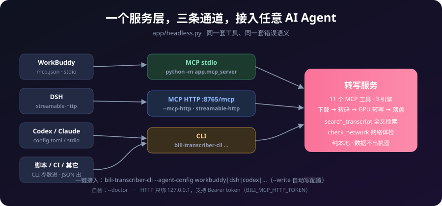

# v0.1.43 — 通用 AI Agent 接入（MCP HTTP + 一键配置 + 检索/体检工具）

这一版让 **DSH、WorkBuddy、Codex、Tare 等各类 AI Agent** 都能真正调上转写能力 —— 不再只是「配置里抄一段 stdio JSON」。



## 新增：MCP HTTP 传输（streamable-http）

stdio 要求客户端自己拉起子进程，有些调用方做不到。新增 `--mcp-http`：

- `POST /mcp` 提交 JSON-RPC（JSON 或 SSE），`GET /healthz` 探活；协议处理与 stdio **完全共用同一份代码**，工具与错误语义一致
- **安全默认值**（都不是可选项而是默认）：只绑 `127.0.0.1`；校验 `Origin` 防 DNS rebinding（非本机 403）；不发 CORS 头；可选 Bearer token（`BILI_MCP_HTTP_TOKEN`）
- 会话管理：闲置 30 分钟回收、上限 64 个淘汰最旧；端口占用自动向后找 20 个
- 打包版同样支持：`bili-transcriber.exe --mcp-http`

> Python 调用方注意：系统代理会把 `127.0.0.1` 的请求也代理出去（Clash 环境实测踩到），用 `ProxyHandler({})` 或设 `no_proxy`。Node/curl/Go 默认不受影响。

## 新增：8 种 AI 客户端一键接入（--agent-config）

同一个 MCP 服务，八种客户端八种配置格式，填错一个键客户端就静默不加载。现在：

```text
bili-transcriber-cli --doctor                        # 自检：装了哪些客户端、缺什么
bili-transcriber-cli --agent-config workbuddy --write # 写进 ~/.workbuddy/mcp.json
bili-transcriber-cli --agent-config codex --transport http --write
```

| 客户端 | 写入 | 说明 |
|---|---|---|
| WorkBuddy | ✅ | JSON `mcpServers`，已有条目原样保留 |
| DSH | ❌ 手动粘贴 | 连接表由界面托管，**拒绝直写**（写坏会让 DSH 起不来） |
| Codex | ✅ | TOML，只写文档化键 + `startup_timeout_sec=300` |
| Claude / Cursor / VS Code / Tare / 通用 | ✅ / 粘贴 | 见 `--agent-list` |

写入前自动备份 `.bak`、只动 `bili-transcriber` 一个条目。

## MCP 工具 9 → 11

| 新工具 | 作用 |
|---|---|
| `search_transcript` | 在已完成任务的转写稿里**全文检索**，返回命中任务、标题与上下文片段 |
| `check_network` | **只读**网络与 Cookie 体检：`quick`（直连+代理）/ `full`（加浏览器、cookies.txt 扫描与自动填写建议）/ `test`（按当前配置逐平台实测） |

顺手加固：`transcribe` / `wait_jobs` 的 `timeout_sec` 夹紧到 86400 秒 —— AI 传 `1e9` 这类"数学上对、实际上挂死"的值不再能把服务占住。

## CLI 新参数

`--grep KEYWORD`（转写稿全文检索）、`--context`、`--mcp-http [PORT]`、`--doctor`、`--agent-config CLIENT`、`--agent-list`、`--transport stdio|http`、`--mcp-port`、`--write`。

## 对抗性审查（三视角多轮收敛）

按 **工具实现者 → 审查者 → AI 使用方** 三轮审查，每轮用真实调用取真实报错作为修复依据（stdio 管道 / 真实 HTTP 请求 / CLI 子进程），记录见 [`docs/adversarial-review.md`](../adversarial-review.md)。抓出的典型问题：

- `McpHttpServer.start()` 只构造对象不起线程 —— 真实 POST 全部挂死，服务端日志零输出
- 标准库 `server_bind` 的 `getfqdn()` 反向解析，在 DNS 被代理接管的机器上启动即挂几十秒
- 过期会话被 `touch()` 复活；CLI `--limit` 参数冲突；`--doctor` 写死打包版路径误报
- DSH 直写会破坏其 `tables` 结构；给 Codex 发明 TOML 键会让整个 config.toml 起不来

## 文档

- README 重写：4 张概念图、20 个使用实例（含 AI 接入/HTTP/检索三例）、33 参数全表
- 用户手册（中英）：命令行与 MCP 章节同步；技术手册（中英）：新增 7.14/7.15 模块小节
- `docs/ai-integration.md`：HTTP 传输、客户端矩阵、6 条新排障项

## 测试与质量

**447 → 512 用例（+65）**：`test_mcp_http.py`（17，含真实 socket 端到端十项）、`test_agent_setup.py`（21）、`test_mcp_server.py` +12、`test_cli.py` +15。全量绿。

## 安装包

| 文件 | 说明 |
|---|---|
| `bili-transcriber-setup-0.1.43.exe` | 安装版（推荐） |
| `bili-transcriber-portable-0.1.43.zip` | 便携版，解压即用 |
| `bili-transcriber-single-0.1.43.exe` | 单文件版（CPU） |
| `bili-transcriber-gpu-0.1.43.zip` | GPU 加速包（NVIDIA CUDA DLL） |
| `bili_transcriber-0.1.43-py3-none-any.whl` | wheel，`pip install` |
| `bili-note-skills-0.1.43.zip` | 配套 AI 技能（bili-note / bili-content-enhance），任何支持技能目录的 Agent 都能用 |

**升级**：安装版直接覆盖安装；便携版解压替换。设置与历史不受影响。
